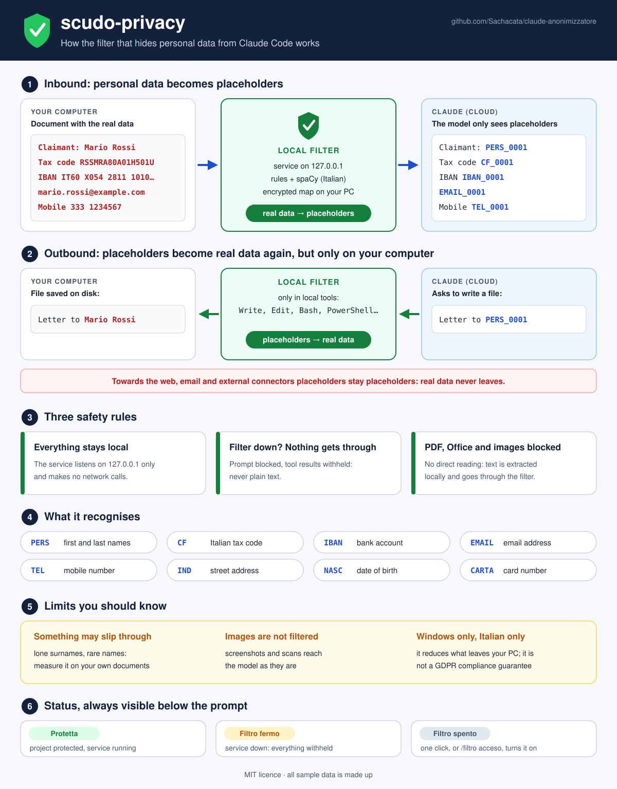

# claude-anonimizzatore

[Italiano](README.md) · **English**

The **scudo-privacy** mod ("privacy shield"): a local pseudonymisation filter for **Claude Code** (CLI and desktop app), built for people who work on Italian documents full of personal data: court rulings, registers, email, case files.

Before any text reaches the model, names, Italian tax codes, IBANs, email addresses, mobile numbers, street addresses and dates of birth are replaced with stable placeholders (`PERS_0001`, `CF_0001`, `IBAN_0001`…). When Claude writes a file or runs a command on your computer, the placeholders turn back into the real data. The model works on your documents without seeing who the people are, and the files on disk stay the real ones.



**Read the [limits](#limits) first.** This is a best-effort filter, not a guarantee: it greatly reduces the personal data leaving your computer, it does not bring it to zero, and it does not replace the assessment of the data controller (GDPR, your organisation's rules).

> **Language note.** The filter recognises **Italian** text (Italian names, tax codes, addresses, legal formulas) and runs on **Windows** only. Commands, messages and configuration keys are in Italian; this page explains each of them.

## How it works

The project has two parts:

| Part | Where | What it does |
|---|---|---|
| **Mod** for Claude Code | `hooks/register.tsx` | intercepts prompts, tool results and tool calls; starts the service; shows the status in the bar below the prompt |
| Python **service** | `servizio/` | recognises personal data (regular expressions + spaCy + a list of Italian first names) and keeps the placeholder ↔ real data map |

About the names: the mod installs as `scudo-privacy`; the command is `/filtro` ("filter") and the project configuration file is called `.filtro-pii.json`.

Ground rules:

- **Local only.** The service listens on `127.0.0.1` and makes no network calls. The map lives in the project (`.filtro-pii\mappa.json`), encrypted; the key is in `%APPDATA%\claude-filtro-pii\chiave.key`.
- **If the service does not answer, nothing gets through.** The prompt is stopped and tool results reach the model as "content withheld". Never plain text.
- **Placeholders turn back into real data only in local tools** (`Read`, `Write`, `Edit`, `MultiEdit`, `NotebookEdit`, `Bash`, `PowerShell`, `Grep`, `Glob`). Towards the web and external connectors they stay placeholders.
- **Direct reading of PDF, Office files, images, `.p7m` and `.msg` is denied**: those files would reach the model whole. Claude extracts their text with a local script, and the output goes through the filter.
- **A project is protected only if you say so**: with a `.filtro-pii.json` file in its folder, or by switching the filter on for the session.

### What it recognises

| Placeholder | Data | How |
|---|---|---|
| `PERS_0001` | first and last names | spaCy, formulas found in legal documents ("nato a", "Avv.", "contro"), register rows, file names, a list of first names, people already known |
| `CF_0001` | Italian tax code (codice fiscale) | shape of the code |
| `IBAN_0001` | Italian IBAN | shape + mod-97 check |
| `EMAIL_0001` | email address | shape |
| `TEL_0001` | Italian mobile number | shape (3xx…, also with +39) |
| `IND_0001` | street address | "via/piazza/corso…" + name + number |
| `NASC_0001` | date of birth | a date after "nato/a … il" |
| `CARTA_0001` | card number | 16 digits + Luhn check |

The same piece of data always gets the same number within a project. A trailing letter (`PERS_0001b`) marks the same person written another way ("Rossi Mario", "MARIO ROSSI"): it lets the filter put back the original text character by character.

## Requirements

- **Windows 10 or 11.** The start script is PowerShell and paths are Windows paths. Linux and macOS are not supported.
- **Claude Code** in a version that loads plugin hooks modules ("mods"). Tested with 2.1.296.
- **Python 3.10 or later** (tested with 3.14), with the `py` launcher.
- About **1.5 GB** free for the Python environment and spaCy's Italian model.

## Installation

Two steps: the Python engine, then the mod.

### 1. Python engine

```powershell
git clone https://github.com/sachacata/claude-anonimizzatore.git
```

```powershell
cd claude-anonimizzatore
```

```powershell
powershell -ExecutionPolicy Bypass -File installa.ps1
```

`installa.ps1` creates a virtual environment in `%LOCALAPPDATA%\claude-filtro-pii\venv`, installs the libraries listed in `servizio\requirements.txt`, downloads the `it_core_news_lg` model (about 570 MB) and runs the tests. It does not touch Claude Code.

If you prefer your own Python, install the libraries and the model by hand, then point the `FILTRO_PII_PYTHON` environment variable to the executable (path of `pythonw.exe`).

### 2. The mod in Claude Code

Pick **just one** of the two ways below: they do the same thing. You install once and it applies to every session, in the terminal and in the desktop app alike.

**Way A — from the terminal (recommended).** Open Claude Code in a terminal and type at the prompt:

```
/plugin install scudo-privacy --marketplace sachacata/claude-anonimizzatore
```

Answer `y` to the marketplace question and choose the user scope (the first entry, just press Enter). Alternatively, the same command from the shell, without opening Claude Code:

```powershell
claude plugin install scudo-privacy --marketplace sachacata/claude-anonimizzatore
```

**Way B — from the desktop app.** The app has no `/plugin` command; use the menu:

1. click **+** next to the prompt box;
2. **Plugins**;
3. **Add marketplace** and type `sachacata/claude-anonimizzatore`;
4. **Add plugin** on the `scudo-privacy` entry.

After A or B, open a **new session**: the mod is installed and nothing else is needed.

<details>
<summary><b>Only if you want to change the code</b> (optional: not needed to use the filter)</summary>

If you want to change the mod's code and see the effect straight away, you can have Claude Code load it directly from the folder cloned in step 1, **instead of** ways A and B (not in addition: the mod would be loaded twice).

Open `%USERPROFILE%\.claude\settings.json` and add the folder to the `CLAUDE_CODE_PLUGIN_DIRS` variable in the `env` block:

```json
{
  "env": {
    "CLAUDE_CODE_PLUGIN_DIRS": "C:\\path\\claude-anonimizzatore"
  }
}
```

Then open a new session.

</details>

## Usage

### Protecting a project

After installing, the filter is **not switched on everywhere**: it only works in the folders you point it to. A "project" is simply the folder you open Claude Code in, the one with your documents. There are two ways to switch it on.

#### Way 1 — always on in that folder (recommended)

Put a small file named `.filtro-pii.json` in the project folder, containing just this line:

```json
{ "attivo": true }
```

To create it without mistakes, open PowerShell **inside the project folder** and run:

```powershell
Set-Content -Path .filtro-pii.json -Value '{ "attivo": true }' -Encoding ascii
```

If you prefer to do it by hand with Notepad: type the line, then **Save as**, choose type "All files" and name it `.filtro-pii.json`. Three things to watch:

- the name starts with a dot;
- it must not become `.filtro-pii.json.txt` (it does if you leave the type as "Text documents");
- the file goes in the folder you open the session in, not in a subfolder.

Then open a **new session** in that folder. From then on the filter switches itself on every time.

#### Way 2 — on for the current session only

No file needed: click the **Filtro spento** ("filter off") label in the bar below the prompt, or type `/filtro acceso`. It lasts until you close the session.

Careful: it applies **from that moment on**. Whatever you had already typed or had Claude read before switching it on has already reached the model in plain text. For real data use way 1.

#### How to tell it is on

- The bar below the prompt shows **🛡 Protetta** ("protected").
- At the first request the service starts by itself: a cold start takes 10-15 seconds, during which the bar says **⚠ Filtro fermo** ("filter down") and nothing gets through. Then it goes back to **🛡 Protetta**.
- Typing `/filtro` shows "Progetto protetto" (project protected) and "servizio attivo" (service running).
- In Claude's answers you see placeholders (`PERS_…`), not names. The files Claude writes to disk contain the real data.

If the bar says **Filtro spento** in a folder where you put the file, the filter is **not protecting you**: check the file's name and location with `/filtro`, which tells you why.

### Commands

| Command | Effect |
|---|---|
| `/filtro` | status: project protected or not (and why), service running or not, session counters |
| `/filtro acceso` | switches the filter **on** for this session |
| `/filtro spento` | switches it **off** for this session (data goes through in plain text again) |
| `/filtro predefinito` | back to **default**: the `.filtro-pii.json` file decides |

Clicking the label in the bar does the same; switching off asks for confirmation.

### Configuration: `.filtro-pii.json`

```json
{
  "attivo": true,
  "esclusi": ["Mario Rossi", "Comune di Esempio", "Ufficio Tributi"],
  "estensioni_bloccate": [".pdf", ".xlsx", ".xlsm", ".xls", ".docx", ".doc", ".pptx", ".png", ".jpg", ".jpeg", ".gif", ".p7m", ".msg"],
  "noti": [
    { "file": "registro.xlsx", "persone": [["Cognome", "Nome"], ["Avvocato"]], "fogli": 1 }
  ]
}
```

| Key | Meaning | If missing |
|---|---|---|
| `attivo` ("active") | `false` keeps the file but switches the filter off | `true` |
| `esclusi` ("excluded") | proper names that must never be masked: yours, your office, your town | none |
| `estensioni_bloccate` ("blocked extensions") | file types the `Read` tool may not open directly | the list above |
| `noti` ("known") | Excel lists of people to recognise always, even by surname alone | none |

**`noti`** is for surnames written on their own ("still to be paid: Bianchi"): with no other clue a surname cannot be told from any other word, and the filter only catches it if that person is already in the map. `file` is the path of the Excel file (relative to the project, or absolute), `persone` lists the groups of columns, by header, that together make up a name; `fogli` says how many sheets to read. The list is read again whenever the file changes.

After changing the configuration while the service is running: `/filtro`, or

```powershell
Invoke-RestMethod -Method Post -Uri http://127.0.0.1:5117/ricarica -ContentType "application/json" -Body '{"progetto":"C:\\path\\project"}'
```

A ready-made example is in [`esempi/`](esempi/).

### Working with placeholders

- Ask for things as usual. Claude reasons on placeholders ("the ruling concerns `PERS_0003`") and writes files with the real names.
- **No attachments or images in the prompt**: in a protected project a prompt with attachments is stopped. Put the file in the folder and ask Claude to extract its text.
- **Email drafts and web searches containing names do not work**: towards the outside, placeholders stay placeholders.
- For checks that need to "see" the data (does a tax code match the name?) have Claude write a script that answers yes or no.

## Before using it with real data

1. Run the **[4-point acceptance test](docs/TESTING.en.md)** with the fake data in `esempi/`. Repeat it after every update of the mod.
2. **Measure the filter on your own documents**, without sending anything to Claude:

   ```powershell
   & "$env:LOCALAPPDATA\claude-filtro-pii\venv\Scripts\python.exe" servizio\misura_a_secco.py C:\path\documents
   ```

   It runs the documents through the engine with a temporary map and writes, in `%TEMP%\filtro-pii-misura\`, the masked text and the list of capitalised words left in plain text. That report contains real data: read it yourself, then bin it. It tells you what slips through in *your* kind of documents.

## Limits

Full list, with examples, in [docs/LIMITS.en.md](docs/LIMITS.en.md). The main ones:

- **Something slips through.** A lone surname of a person never seen before, a lone first name, foreign or rare names in lower case, postcode and town, landline numbers. On the documents it was tried on (896 litigation files) a handful of cases stayed in plain text out of more than 18,000 replacements; yours may behave differently: measure.
- **Images do not go through the filter.** Screenshots, page zooms and scans reach the model as they are. In the browser: never take screenshots of pages with real data.
- **False positives.** Capitalised common words and names of tools, folders or variables can become `PERS_…`. It is not a leak, but it is confusing. Fix it with `esclusi`.
- **Italian only, Windows only.**
- **Switching it on mid-session does not protect what has already gone through.**
- **The map contains the real data** (encrypted, with the key on the same computer): it protects against an accidental copy of the project, not against someone with access to your user profile.

## Where things are

| What | Where |
|---|---|
| Project map (encrypted) | `<project>\.filtro-pii\mappa.json` |
| Map key | `%APPDATA%\claude-filtro-pii\chiave.key` |
| Python environment | `%LOCALAPPDATA%\claude-filtro-pii\venv` |
| Service log (sizes and timings only, never text) | `%LOCALAPPDATA%\claude-filtro-pii\log\servizio.log` |

The service adds `.filtro-pii/` to the project's `.gitignore`. **Never put the map in a repository.** If you lose the key, existing maps can no longer be read (files on disk are untouched: you start again with a new map).

To reset a project's map: stop the service, delete `.filtro-pii\mappa.json`, start it again. Placeholders restart from 0001 and those in open sessions are no longer valid: continue in a new session.

## Troubleshooting

| Symptom | What to do |
|---|---|
| The bar says **⚠ Filtro fermo** for more than half a minute | run `servizio\avvia_servizio.ps1` by hand in the mod's folder and look at the log |
| `/filtro` says the project is not protected | read the diagnosis line: usually `.filtro-pii.json` is not in the folder the session was opened in |
| Results arrive as "contenuto trattenuto" (content withheld) | the service went down: it restarts at your next message, or start it by hand |
| `Edit` refused with "a hook changed this call's input" | in auto mode the app refuses edits in which the mod has put real data back: approve by hand, or have Claude edit a stretch of text with no names in it |
| A name appears in a file where you wanted the literal placeholder | in local tools placeholders always turn back into real data: to write one literally, split it (`"PERS" + "_0001"`) |
| You want to stop the service | `Invoke-RestMethod -Method Post -Uri http://127.0.0.1:5117/arresta` |

## Development

```powershell
py -m unittest discover -s servizio -p "test_motore.py"
```

```powershell
claude plugin validate .
```

```powershell
claude plugin test .
```

Layout:

```
.claude-plugin/   mod and marketplace manifests
hooks/            register.tsx (the mod) and its tests
types/            types of the mod's state
servizio/         motore.py (recognition), mappa.py (encrypted map), servizio.py (local HTTP),
                  semina.py ("noti" lists), nomi_battesimo.py, misura_a_secco.py, ripristina_file.py
esempi/           made-up data for the acceptance test
docs/             limits, acceptance test, infographic
```

The service exposes, on `127.0.0.1` only: `GET /stato`, `POST /anonimizza {progetto, testo}`, `POST /ripristina {progetto, testo}`, `POST /ricarica {progetto}`, `POST /arresta`.

All data in the tests and examples is made up. If you contribute, never include real people's data, not even in commit messages or issues: to describe a leak, reproduce it with invented names.

## Support the project

If this tool is useful to you, you can buy me a coffee: [buymeacoffee.com/sachacata](https://buymeacoffee.com/sachacata).

## Licence

[MIT](LICENSE). The software is provided as is, with no warranty: whoever uses it remains responsible for the data they process.
