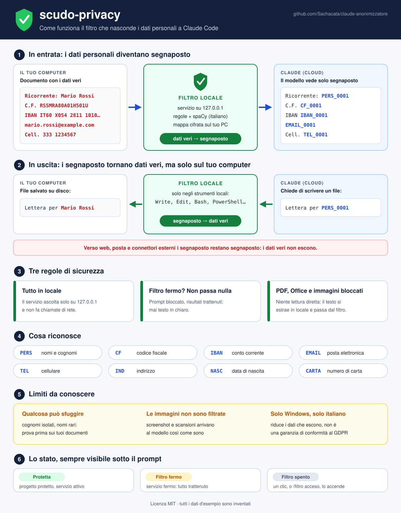

# claude-anonimizzatore

**Italiano** · [English](README.en.md)

La mod **scudo-privacy**: un filtro locale di pseudonimizzazione per **Claude Code** (CLI e app desktop), pensato per chi lavora su documenti italiani con dati personali: sentenze, registri, posta, pratiche.

Prima che un testo arrivi al modello, nomi, codici fiscali, IBAN, email, telefoni, indirizzi e date di nascita vengono sostituiti da segnaposto stabili (`PERS_0001`, `CF_0001`, `IBAN_0001`…). Quando Claude scrive un file o lancia un comando sul tuo computer, i segnaposto tornano dati reali. Il modello lavora sui documenti senza vedere chi sono le persone, e i file su disco restano quelli veri.



**Leggi prima i [limiti](#limiti).** È un filtro «al meglio», non una garanzia: riduce molto i dati personali che escono dal computer, non li azzera, e non sostituisce le valutazioni del titolare del trattamento (GDPR, regole del tuo ente).

## Come funziona

```
            tu scrivi                    strumenti locali leggono file
               │                                    │
               ▼                                    ▼
   ┌───────────────────────────── mod scudo-privacy ──────────────────────────┐
   │  prompt e risultati degli strumenti  ──►  servizio locale 127.0.0.1:5117  │
   │                                            dati reali ──► segnaposto      │
   └──────────────────────────────────┬───────────────────────────────────────┘
                                      ▼
                         Claude vede solo PERS_0001, CF_0001…
                                      │
                                      ▼
   ┌───────────────────────────── mod scudo-privacy ──────────────────────────┐
   │  Write, Edit, Bash, PowerShell, Grep…:  segnaposto ──► dati reali        │
   └──────────────────────────────────────────────────────────────────────────┘
```

Il progetto ha due parti:

| Parte | Dove | Cosa fa |
|---|---|---|
| **Mod** per Claude Code | `hooks/register.tsx` | intercetta prompt, risultati e chiamate agli strumenti; avvia il servizio; mostra lo stato nella barra sotto il prompt |
| **Servizio** Python | `servizio/` | riconosce i dati personali (espressioni regolari + spaCy + elenco di nomi di battesimo) e tiene la mappa segnaposto ↔ dati reali |

Sui nomi: la mod si installa come `scudo-privacy`; il comando è `/filtro` e il file di configurazione del progetto si chiama `.filtro-pii.json` («pii» sta per dati personali identificativi).

Regole di fondo:

- **Solo in locale.** Il servizio ascolta su `127.0.0.1` e non fa chiamate di rete. La mappa sta nel progetto (`.filtro-pii\mappa.json`), cifrata; la chiave sta in `%APPDATA%\claude-filtro-pii\chiave.key`.
- **Se il servizio non risponde non passa nulla.** Il prompt viene fermato e i risultati degli strumenti arrivano al modello come «contenuto trattenuto». Mai testo in chiaro.
- **I segnaposto tornano dati reali solo negli strumenti locali** (`Read`, `Write`, `Edit`, `MultiEdit`, `NotebookEdit`, `Bash`, `PowerShell`, `Grep`, `Glob`). Verso il web e i connettori esterni restano segnaposto.
- **La lettura diretta di PDF, Office, immagini, `.p7m` e `.msg` è negata**: quei file arriverebbero interi al modello. Claude ne estrae il testo con uno script locale, e l'output passa dal filtro.
- **Un progetto è protetto solo se lo dici tu**: con un file `.filtro-pii.json` nella sua cartella, o accendendo il filtro per la sessione.

### Cosa riconosce

| Segnaposto | Dato | Come |
|---|---|---|
| `PERS_0001` | nomi e cognomi | spaCy, formule degli atti («nato a», «Avv.», «contro»), righe di registro, nomi di file, elenco di nomi di battesimo, persone già note |
| `CF_0001` | codice fiscale | forma del codice (anche con omocodia) |
| `IBAN_0001` | IBAN italiano | forma + controllo mod-97 |
| `EMAIL_0001` | indirizzo email | forma |
| `TEL_0001` | cellulare italiano | forma (3xx…, anche con +39) |
| `IND_0001` | indirizzo | «via/piazza/corso…» + nome + civico |
| `NASC_0001` | data di nascita | data dopo «nato/a … il» |
| `CARTA_0001` | numero di carta | 16 cifre + controllo di Luhn |

Lo stesso dato ha sempre lo stesso numero dentro un progetto. Una lettera in coda (`PERS_0001b`) indica la stessa persona scritta in un altro modo («Rossi Mario», «MARIO ROSSI»): serve a rimettere il testo originale carattere per carattere.

## Requisiti

- **Windows 10 o 11.** Lo script di avvio è PowerShell e i percorsi sono quelli di Windows. Linux e macOS non sono supportati.
- **Claude Code** in una versione che carica i moduli hook dei plugin (le «mod»). Provato con la 2.1.296.
- **Python 3.10 o successivo** (provato con la 3.14), con il launcher `py`.
- Circa **1,5 GB** liberi per l'ambiente Python e il modello italiano di spaCy.

## Installazione

Sono due passi: il motore Python, poi la mod.

### 1. Motore Python

```powershell
git clone https://github.com/sachacata/claude-anonimizzatore.git
```

```powershell
cd claude-anonimizzatore
```

```powershell
powershell -ExecutionPolicy Bypass -File installa.ps1
```

`installa.ps1` crea un ambiente virtuale in `%LOCALAPPDATA%\claude-filtro-pii\venv`, installa le librerie di `servizio\requirements.txt`, scarica il modello `it_core_news_lg` (circa 570 MB) e lancia i test. Non tocca Claude Code.

Se preferisci il tuo Python, installa a mano le librerie e il modello, poi indica l'eseguibile nella variabile d'ambiente `FILTRO_PII_PYTHON` (percorso di `pythonw.exe`).

### 2. Mod in Claude Code

Da un terminale con Claude Code aperto:

```
/plugin install scudo-privacy --marketplace sachacata/claude-anonimizzatore
```

Rispondi `y` alla domanda sul marketplace e scegli l'ambito utente. Oppure dalla shell:

```powershell
claude plugin install scudo-privacy --marketplace sachacata/claude-anonimizzatore
```

Nell'app desktop il comando `/plugin` non c'è: **+** accanto al prompt → **Plugins** → **Add marketplace** con `sachacata/claude-anonimizzatore` → **Add plugin**. Una mod installata dal terminale nell'ambito utente vale anche per le sessioni locali dell'app desktop.

**In alternativa, dalla cartella clonata** (comodo se vuoi modificare il codice): aggiungi la cartella alla variabile `CLAUDE_CODE_PLUGIN_DIRS` nel blocco `env` di `%USERPROFILE%\.claude\settings.json`:

```json
{
  "env": {
    "CLAUDE_CODE_PLUGIN_DIRS": "C:\\percorso\\claude-anonimizzatore"
  }
}
```

Dopo l'installazione apri una **sessione nuova**.

## Uso

### Proteggere un progetto

Crea un file `.filtro-pii.json` nella cartella del progetto. Basta questo:

```json
{ "attivo": true }
```

Da quel momento, in ogni sessione aperta in quella cartella:

- nella barra sotto il prompt compare **🛡 Protetta**;
- alla prima richiesta il servizio parte da solo (a freddo servono 10-15 secondi: nel frattempo la barra dice **⚠ Filtro fermo** e nulla passa);
- nelle risposte di Claude vedi i segnaposto, non i nomi. I file che Claude scrive contengono i dati reali.

Per un progetto senza file puoi accendere il filtro per la sola sessione: clic su **Filtro spento** nella barra, oppure `/filtro acceso`. Vale da quel momento in poi: ciò che è già in chat è già passato in chiaro.

### Comandi

| Comando | Effetto |
|---|---|
| `/filtro` | stato: progetto protetto o no (e perché), servizio attivo o no, contatori della sessione |
| `/filtro acceso` | accende il filtro in questa sessione |
| `/filtro spento` | lo spegne in questa sessione (i dati tornano a passare in chiaro) |
| `/filtro predefinito` | torna a decidere il file `.filtro-pii.json` |

Il clic sulla scritta nella barra fa la stessa cosa; per spegnere chiede conferma.

### Configurazione: `.filtro-pii.json`

```json
{
  "attivo": true,
  "esclusi": ["Mario Rossi", "Comune di Esempio", "Ufficio Tributi"],
  "estensioni_bloccate": [".pdf", ".xlsx", ".xlsm", ".xls", ".docx", ".doc", ".pptx", ".png", ".jpg", ".jpeg", ".gif", ".p7m", ".msg"],
  "noti": [
    { "file": "registro.xlsx", "persone": [["Cognome", "Nome"], ["Avvocato"]], "fogli": 1 }
  ]
}
```

| Chiave | Significato | Se manca |
|---|---|---|
| `attivo` | `false` lascia il file ma spegne il filtro | `true` |
| `esclusi` | nomi propri da non mascherare mai: il tuo, il tuo ufficio, la tua città | nessuno |
| `estensioni_bloccate` | tipi di file che lo strumento `Read` non può aprire direttamente | l'elenco qui sopra |
| `noti` | elenchi Excel di persone da riconoscere sempre, anche col solo cognome | nessuno |

**`noti`** serve per i cognomi scritti da soli («resta da pagare Bianchi»): senza altri indizi un cognome non si distingue da una parola qualsiasi, e il filtro lo prende solo se quella persona è già nella mappa. `file` è il percorso dell'Excel (relativo al progetto o assoluto), `persone` elenca i gruppi di colonne, per intestazione, che insieme fanno un nominativo; `fogli` dice quanti fogli leggere. L'elenco viene riletto quando il file cambia.

Dopo aver cambiato la configurazione a servizio acceso: `/filtro`, oppure

```powershell
Invoke-RestMethod -Method Post -Uri http://127.0.0.1:5117/ricarica -ContentType "application/json" -Body '{"progetto":"C:\\percorso\\progetto"}'
```

Un esempio pronto è in [`esempi/`](esempi/).

### Lavorare con i segnaposto

- Chiedi le cose come sempre. Claude ragiona sui segnaposto («la sentenza riguarda `PERS_0003`») e scrive file con i nomi veri.
- **Niente allegati né immagini nel prompt**: in un progetto protetto il prompt con allegati viene fermato. Metti il file nella cartella e chiedi di estrarne il testo.
- **Bozze di posta e ricerche web con nomi dentro non funzionano**: verso l'esterno i segnaposto restano segnaposto.
- Per controlli che richiedono di «vedere» i dati (un codice fiscale corrisponde al nome?) fatti scrivere uno script che risponda sì/no.

## Prima di usarlo con dati veri

1. Fai il **[collaudo in 4 punti](docs/COLLAUDO.md)** con i dati finti di `esempi/`. Va ripetuto a ogni aggiornamento della mod.
2. **Misura il filtro sui tuoi documenti**, senza mandare nulla a Claude:

   ```powershell
   & "$env:LOCALAPPDATA\claude-filtro-pii\venv\Scripts\python.exe" servizio\misura_a_secco.py C:\percorso\documenti
   ```

   Passa i documenti nel motore con una mappa temporanea e scrive in `%TEMP%\filtro-pii-misura\` il testo mascherato e l'elenco delle parole con la maiuscola rimaste in chiaro. Quel rapporto contiene dati reali: leggilo tu e poi cestinalo. Ti dice che cosa sfugge nel *tuo* tipo di documenti.

## Limiti

Elenco completo, con esempi, in [docs/LIMITI.md](docs/LIMITI.md). I principali:

- **Qualcosa sfugge.** Cognome da solo di una persona mai vista, nome di battesimo da solo, nomi stranieri o rari scritti in minuscolo, CAP e comune, telefoni fissi. Sui documenti provati (896 file di contenzioso) restavano in chiaro pochi casi su oltre 18.000 sostituzioni; sui tuoi può andare diversamente: misura.
- **Le immagini non passano dal filtro.** Screenshot, zoom di pagina e scansioni arrivano al modello come sono. Nel browser: mai screenshot su pagine con dati reali.
- **Falsi positivi.** Parole comuni con la maiuscola, nomi di strumenti, di cartelle o di variabili possono diventare `PERS_…`. Non è una fuga, ma confonde. Si rimedia con `esclusi`.
- **Solo italiano, solo Windows.**
- **Accenderlo a metà sessione non protegge ciò che è già passato.**
- **La mappa contiene i dati reali** (cifrati, con la chiave sullo stesso computer): protegge da una copia accidentale del progetto, non da chi ha accesso al tuo profilo utente.

## Dove stanno le cose

| Cosa | Dove |
|---|---|
| Mappa del progetto (cifrata) | `<progetto>\.filtro-pii\mappa.json` |
| Chiave della mappa | `%APPDATA%\claude-filtro-pii\chiave.key` |
| Ambiente Python | `%LOCALAPPDATA%\claude-filtro-pii\venv` |
| Log del servizio (solo dimensioni e tempi, mai testo) | `%LOCALAPPDATA%\claude-filtro-pii\log\servizio.log` |

Il servizio aggiunge `.filtro-pii/` al `.gitignore` del progetto. **Non mettere mai la mappa in un repository.** Se perdi la chiave, le mappe esistenti non si leggono più (i file su disco restano intatti: si riparte con una mappa nuova).

Per azzerare la mappa di un progetto: ferma il servizio, cancella `.filtro-pii\mappa.json`, riavvia. I segnaposto ripartono da 0001 e quelli delle sessioni aperte non valgono più: continua in una sessione nuova.

## Se qualcosa non va

| Sintomo | Cosa fare |
|---|---|
| La barra dice **⚠ Filtro fermo** per più di mezzo minuto | lancia a mano `servizio\avvia_servizio.ps1` nella cartella della mod e guarda il log |
| `/filtro` dice «progetto non protetto» | leggi la riga di diagnosi: di solito `.filtro-pii.json` non è nella cartella in cui è aperta la sessione |
| I risultati arrivano come «contenuto trattenuto» | il servizio è caduto: riparte al tuo messaggio successivo, oppure avvialo a mano |
| `Edit` rifiutato con «a hook changed this call's input» | in modalità automatica l'app rifiuta le modifiche in cui la mod ha rimesso un dato reale: approva a mano, o fai modificare una porzione di testo senza nomi |
| In un file compare un nome dove volevi il segnaposto alla lettera | negli strumenti locali i segnaposto tornano sempre dati reali: per scriverne uno letterale va spezzato (`"PERS" + "_0001"`) |
| Vuoi fermare il servizio | `Invoke-RestMethod -Method Post -Uri http://127.0.0.1:5117/arresta` |

## Sviluppo

```powershell
py -m unittest discover -s servizio -p "test_motore.py"
```

```powershell
claude plugin validate .
```

```powershell
claude plugin test .
```

Struttura:

```
.claude-plugin/   manifest della mod e del marketplace
hooks/            register.tsx (la mod) e i suoi test
types/            tipi dello stato della mod
servizio/         motore.py (riconoscimento), mappa.py (mappa cifrata), servizio.py (HTTP locale),
                  semina.py (elenchi «noti»), nomi_battesimo.py, misura_a_secco.py, ripristina_file.py
esempi/           dati inventati per il collaudo
docs/             limiti, collaudo, infografica
```

Il servizio espone, solo su `127.0.0.1`: `GET /stato`, `POST /anonimizza {progetto, testo}`, `POST /ripristina {progetto, testo}`, `POST /ricarica {progetto}`, `POST /arresta`.

Tutti i dati nei test e negli esempi sono inventati. Se contribuisci, non inserire mai dati di persone reali, nemmeno nei messaggi di commit o nelle segnalazioni: per descrivere una fuga, riproducila con nomi di fantasia.

## Sostieni il progetto

Se questo strumento ti è utile, puoi offrirmi un caffè: [buymeacoffee.com/sachacata](https://buymeacoffee.com/sachacata).

## Licenza

[MIT](LICENSE). Il software è fornito così com'è, senza garanzie: chi lo usa resta responsabile dei dati che tratta.
